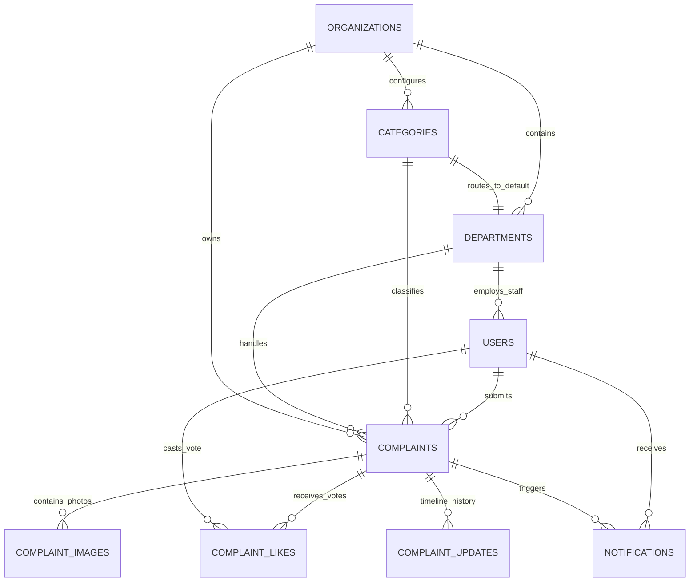
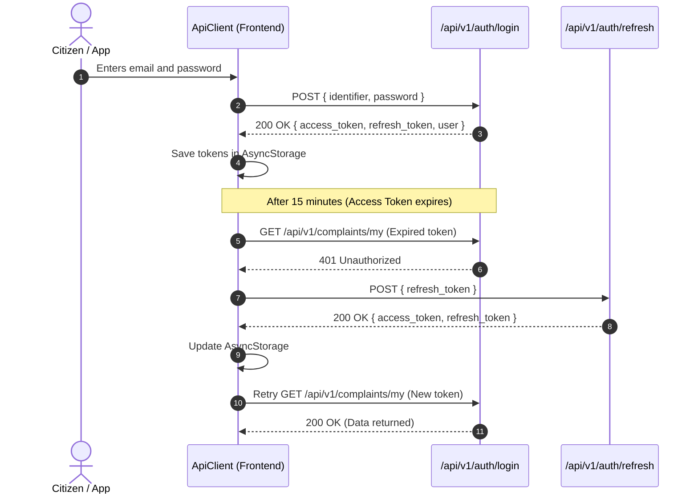
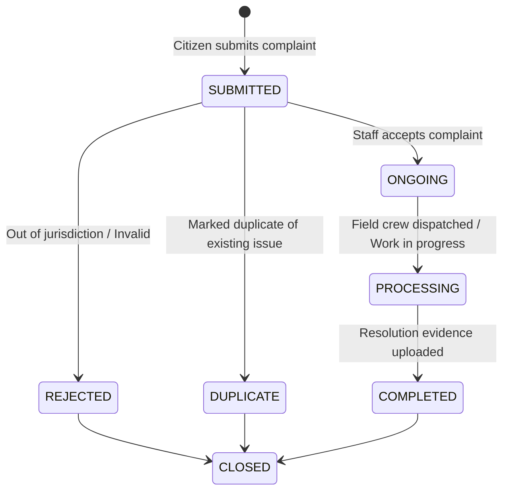

# Voice2Gov — Complete Architecture, Codeflow & Developer Guide

> **Note**: This file is mirrored at the project root as [`PROJECT_GUIDE.md`](file:///d:/projects/main(or working)/voice2Gov1/voice2Gov1/voice2Gov1/PROJECT_GUIDE.md).

## Table of Contents
1. [Project Overview & Mission](#1-project-overview--mission)
2. [Monorepo Directory Structure](#2-monorepo-directory-structure)
3. [Technology Stack & Dependencies (What & Why)](#3-technology-stack--dependencies-what--why)
   - [3.1 Backend Dependencies](#31-backend-dependencies)
   - [3.2 Frontend Dependencies](#32-frontend-dependencies)
4. [Models Architecture & Data Relationships](#4-models-architecture--data-relationships)
   - [4.1 Database Models & Entity-Relationship Diagram](#41-database-models--entity-relationship-diagram)
   - [4.2 Collections & Schemas Deep Dive](#42-collections--schemas-deep-dive)
   - [4.3 AI & Algorithmic Models](#43-ai--algorithmic-models)
5. [System Architecture & Execution Flow](#5-system-architecture--execution-flow)
   - [5.1 Backend Clean Architecture](#51-backend-clean-architecture)
   - [5.2 Frontend Component & Navigation Architecture](#52-frontend-component--navigation-architecture)
6. [Frontend ↔ Backend Communication & API Payloads](#6-frontend--backend-communication--api-payloads)
   - [6.1 Standard API Envelope](#61-standard-api-envelope)
   - [6.2 Authentication & Token Refresh Flow](#62-authentication--token-refresh-flow)
   - [6.3 Complaint Submission Lifecycle (Voice & Text)](#63-complaint-submission-lifecycle-voice--text)
   - [6.4 Community Feed & Upvoting Mechanics](#64-community-feed--upvoting-mechanics)
   - [6.5 Organization Staff Resolution Lifecycle](#65-organization-staff-resolution-lifecycle)
7. [Local Setup & Running Instructions](#7-local-setup--running-instructions)
   - [7.1 Prerequisites](#71-prerequisites)
   - [7.2 Backend Setup](#72-backend-setup)
   - [7.3 Frontend Setup](#73-frontend-setup)
8. [Developer Cheat-Sheet for Adding New Features](#8-developer-cheat-sheet-for-adding-new-features)

---

## 1. Project Overview & Mission

**Voice2Gov** is a **citizen-centric civic complaint management platform** that bridges the communication gap between citizens and municipal/civic government organizations (such as Municipal Corporations, Water Supply Boards, Public Works Departments, and Electricity Boards).

### The Core Problem It Solves:
Traditional civic grievance portals are often cumbersome, text-heavy, English-only, and opaque. Voice2Gov solves this through:
- **Voice-First Accessibility**: Citizens can speak their complaint in vernacular languages/dialects (e.g., Hindi, Tamil, Telugu). The system transcribes, translates, and structures it into an official civic grievance report.
- **Deterministic Routing**: Every complaint category belongs to an organization and specifies a default department. Submissions automatically route to the right department without human triage delay.
- **Community Upvoting & Dynamic Priority Scoring**: Complaints visible in a public feed can be upvoted by neighbors. Community support, category severity, and elapsed time dynamically escalate urgent issues to the top of staff queues.
- **Multi-Role Portals**: A single unified architecture supporting Citizens, Organization Staff, Organization Admins, and Super Administrators.

---

## 2. Monorepo Directory Structure

```
voice2Gov1/
├── backend/                       # Python FastAPI Backend
│   ├── app/
│   │   ├── api/v1/                # HTTP REST Route handlers (auth, complaints, feed, org, etc.)
│   │   ├── core/                  # Settings, config (.env validation), constants
│   │   ├── db/                    # PyMongo Async connection manager & indexes
│   │   ├── dependencies/          # FastAPI DI (Auth, RBAC, Services, Rate limits)
│   │   ├── exceptions/            # Custom domain exceptions & global HTTP handlers
│   │   ├── middleware/            # Rate limiting, security headers, CORS
│   │   ├── repositories/          # Data access layer (MongoDB CRUD operations)
│   │   ├── schemas/               # Pydantic validation contracts & DTOs
│   │   ├── services/              # Domain business logic & state machines
│   │   └── storage/               # File storage abstraction (local disk / S3)
│   ├── scripts/                   # Index creation and database utilities
│   ├── tests/                     # Unit, integration, security & concurrency tests
│   ├── requirements.txt           # Python package dependencies
│   └── pyproject.toml             # Tool configurations (pytest, ruff, mypy)
│
├── frontend/                      # React Native / Expo Mobile & Web App
│   ├── src/
│   │   ├── api/                   # Typed API client & endpoint modules (client.ts, complaints.ts, etc.)
│   │   ├── components/            # Reusable UI widgets, buttons, glass cards, AI Orb, waveforms
│   │   ├── context/               # React Contexts (AuthContext, ThemeContext)
│   │   ├── screens/               # Application views
│   │   │   ├── admin/             # Super-admin portal screens
│   │   │   ├── auth/              # Login, Register, OTP verification screens
│   │   │   ├── complaints/        # My Complaints, Details, Community Feed screens
│   │   │   ├── foundation/        # Splash & Onboarding screens
│   │   │   ├── home/              # Main Citizen dashboard
│   │   │   ├── org/               # Organization staff & admin dashboard
│   │   │   ├── utility/           # Search, Notifications, Profile screens
│   │   │   └── voice/             # Voice recording, AI processing & Review screens
│   │   └── theme/                 # Design tokens (dark/light palettes, typography, radius)
│   ├── App.tsx                    # Screen router & state orchestrator
│   └── package.json               # JavaScript dependencies & Expo scripts
│
└── docs/                          # Architecture specs, DB schemas, SRS documentation
```

---

## 3. Technology Stack & Dependencies (What & Why)

### 3.1 Backend Dependencies

Located in `backend/requirements.txt`:

| Package | Purpose | Why We Use It |
| :--- | :--- | :--- |
| **`fastapi` (>=0.109.0)** | REST API Web Framework | Asynchronous performance, native dependency injection, automatic OpenAPI/Swagger (`/docs`) generation, and strict Pydantic integration. |
| **`uvicorn[standard]` (>=0.27.0)** | ASGI Web Server | Production-ready asynchronous HTTP server implementation for FastAPI with auto-reload capabilities. |
| **`pymongo` (>=4.6.0)** | MongoDB Driver | Uses native `pymongo.asynchronous.AsyncMongoClient` for fully non-blocking database queries. |
| **`pydantic` (>=2.5.0) & `pydantic-settings`** | Data Contracts & Configuration | Validates all incoming payloads, serializes outgoing data, and validates `.env` configuration at startup. |
| **`python-jose[cryptography]`** | JWT Authentication | Signs and verifies stateless JWT Access Tokens and Refresh Tokens. |
| **`bcrypt` (>=4.1.0)** | Password Hashing | Secure one-way hashing with salt (cost factor 12) for user account credentials. |
| **`python-multipart`** | Form & File Parsing | Enables receiving multipart form uploads (evidence photos, progress images). |
| **`python-dotenv`** | Config Management | Automatically parses `.env` files into environment variables. |
| **`httpx`** | Async HTTP Client | Used in integration tests to simulate asynchronous requests against the FastAPI test client. |
| **`pytest`, `pytest-asyncio`, `pytest-cov`** | Testing Suite | Automated testing runner with asynchronous fixture support and code coverage reports. |
| **`ruff`, `mypy`, `bandit`** | Linting & Security | Code styling, strict PEP 484 static type checking, and automated AST security vulnerability scanning. |

### 3.2 Frontend Dependencies

Located in `frontend/package.json`:

| Package | Purpose | Why We Use It |
| :--- | :--- | :--- |
| **`expo` (~57.0.27)** | Mobile Platform Framework | Cross-platform build tools and SDK for Android, iOS, and Web deployment. |
| **`react` (19.2.3) & `react-native` (0.86.3)** | Core UI Engine | Component hierarchy, functional hooks (`useState`, `useEffect`, `useContext`), and mobile UI primitives. |
| **`@react-native-async-storage/async-storage`** | Local Key-Value Persistence | Stores user tokens (`@v2g_access_token`, `@v2g_refresh_token`) and profile data across sessions. |
| **`react-native-svg` (15.15.4)** | Vector Graphics | Renders resolution-independent SVG icons, waveforms, and visual animations (such as the AI Orb). |
| **`react-native-web` (^0.21.2)** | Web Compatibility | Maps React Native mobile views to standard HTML5/DOM elements for browser development. |
| **`typescript` (~6.0.3)** | Type Safety | Enforces contract interfaces matching backend Pydantic models. |

---

## 4. Models Architecture & Data Relationships

### 4.1 Database Models & Entity-Relationship Diagram

All collections use MongoDB `ObjectId` string primary keys with application-level foreign key validation:



### 4.2 Collections & Schemas Deep Dive

1. **`users`** (`app/schemas/user.py`):
   - Stores citizen and official accounts.
   - Fields: `_id`, `email`, `phone`, `password_hash`, `full_name`, `role` (`citizen`, `organization_staff`, `organization_admin`, `admin`), `organization_id`, `department_id`, `is_verified`.
2. **`organizations`** (`app/schemas/organization.py`):
   - Civic authorities (e.g., Delhi Municipal Corporation, Bangalore Water Board).
   - Fields: `_id`, `name`, `code` (unique, uppercase), `description`, `settings` (SLA hours, auto-assign).
3. **`departments`** (`app/schemas/department.py`):
   - Specific divisions inside an organization (e.g., Sanitation, Roads & Bridges, Electrical).
   - Fields: `_id`, `organization_id`, `name`, `code`, `head_user_id`.
4. **`categories`** (`app/schemas/category.py`):
   - Complaint classification types (e.g., "Pothole", "Street Light Failure", "Water Contamination").
   - Fields: `_id`, `organization_id`, `name`, `default_department_id`, `severity_level` (1 to 5), `priority_weight`.
   - **Crucial Rule**: When a category is chosen, the backend uses `organization_id` and `default_department_id` to route the complaint without manual intervention.
5. **`complaints`** (`app/schemas/complaint.py`):
   - Central grievance records submitted by citizens.
   - Fields: `_id`, `complaint_number` (e.g., `CMP-2024-000001`), `user_id`, `organization_id`, `department_id`, `category_id`, `title`, `description`, `status` (`SUBMITTED`, `ONGOING`, `PROCESSING`, `COMPLETED`, `REJECTED`, `DUPLICATE`, `CLOSED`), `visibility` (`public`, `organization`, `private`), `location` (GeoJSON `Point` `[longitude, latitude]`), `address`, `priority_score` (0–100), `severity_score` (1–5), `likes_count`.
6. **`complaint_images`** (`app/schemas/complaint_image.py`):
   - Evidence, progress, and completion photos.
   - Fields: `_id`, `complaint_id`, `image_type` (`evidence`, `progress`, `completion`), `storage_path`, `checksum` (SHA-256), `uploaded_by`.
7. **`complaint_likes`** (`app/schemas/complaint.py`):
   - Community votes on public complaints.
   - Compound Unique Index: `(complaint_id, user_id)` guarantees one vote per citizen.
8. **`complaint_updates`** (`app/schemas/complaint_update.py`):
   - Audit trail and status change messages logged by staff.
   - Fields: `_id`, `complaint_id`, `updated_by`, `update_type`, `previous_status`, `new_status`, `message`, `images`.
9. **`notifications`** (`app/schemas/notification.py`):
   - Alerts generated for users on status updates or upvotes.

---

### 4.3 AI & Algorithmic Models

#### A. Voice & AI Processing Model
In `frontend/src/screens/voice/`:
1. **Audio Recording** (`VoiceComplaintScreen.tsx`): Captures native voice input with live waveform and timer visualization.
2. **AI Analysis Pipeline** (`AIProcessingScreen.tsx`):
   - **Multi-dialect Transcription**: Converts spoken audio into text.
   - **Translation**: Translates regional text into standardized English.
   - **Entity Extraction**: Automatically infers civic issue summary, category, and severity.
3. **Review & Correction** (`ComplaintReviewScreen.tsx`): Pre-populates the title, description, and location for citizen confirmation before submission.

#### B. Dynamic Priority Calculation Engine
Implemented in `backend/app/services/priority_service.py`:

$$\text{Priority Score} = (\text{Severity} \times 0.40) + (\text{Community Likes} \times 0.30) + (\text{Age} \times 0.20) + (\text{Org Boost} \times 0.10)$$

- **Severity (40%)**: Derived from category severity (1 = minor, 5 = critical hazard).
- **Community Likes (30%)**: Scaled score based on public feed upvotes.
- **Age Factor (20%)**: Linearly increases up to 168 hours (7 days) so neglected complaints naturally rise to the top.
- **Organization Boost (10%)**: Emergency priority multiplier assigned by admins.

---

## 5. System Architecture & Execution Flow

```
┌─────────────────────────────────────────────────────────────┐
│                 FRONTEND (Expo / React Native)              │
│  App.tsx (Screen Router) ↔ AuthContext / ThemeContext       │
│  Screens: Voice, Review, Feed, My Complaints, Dashboards    │
│  ApiClient (Fetch / Axios + Auto Bearer JWT + 401 Refresh)  │
└──────────────────────────────▲──────────────────────────────┘
                               │ HTTP REST (JSON)
                               ▼
┌─────────────────────────────────────────────────────────────┐
│                 BACKEND (FastAPI / Python)                  │
│ 1. Middleware: CORS, Security Headers, Rate Limiter         │
│ 2. API Router: /api/v1/ (auth, complaints, feed, etc.)      │
│ 3. Dependencies: Token verification & RBAC role checks      │
│ 4. Service Layer: ComplaintService, PriorityService, etc.   │
│ 5. Repository Layer: Abstracted MongoDB CRUD queries        │
│ 6. Async Database: PyMongo AsyncMongoClient                 │
└──────────────────────────────▲──────────────────────────────┘
                               │ Non-blocking BSON
                               ▼
┌─────────────────────────────────────────────────────────────┐
│                 DATABASE (MongoDB 7.0+)                     │
│ Collections: users, complaints, categories, likes, updates  │
│ Indexes: 2dsphere (geospatial), unique compound constraints │
└─────────────────────────────────────────────────────────────┘
```

### 5.1 Backend Clean Architecture
Every request follows strict layer separation:
1. **Middleware Layer** (`app/middleware/`): Enforces CORS, appends security headers (CSP, HSTS), and tracks IP rate limits.
2. **API Layer** (`app/api/v1/`): Decodes HTTP parameters, validates authentication tokens via FastAPI `Depends()`, and enforces Role-Based Access Control (RBAC).
3. **Service Layer** (`app/services/`): Houses all business rules, complaint state transitions, sequential number generation, and priority calculations.
4. **Repository Layer** (`app/repositories/`): Performs isolated MongoDB queries and aggregations.
5. **Database Client** (`app/db/database.py`): Manages the connection pool via `AsyncMongoClient`.

### 5.2 Frontend Component & Navigation Architecture
1. **Root Router** (`App.tsx`):
   - Observes `isAuthenticated` from `AuthContext`.
   - Mounts auth screens (`welcome`, `login`, `register`, `otp_verification`) or authenticated screens (`home`, `voice_record`, `complaint_review`, `complaints`, `feed`, `org_dashboard`, `admin_dashboard`).
2. **Auth Context** (`src/context/AuthContext.tsx`):
   - Reads stored tokens from `AsyncStorage` on app start.
   - Runs background verification against `GET /api/v1/auth/me`.
3. **API Client** (`src/api/client.ts`):
   - Attaches `Authorization: Bearer <token>` to headers.
   - Intercepts `401 Unauthorized` responses and silently requests a refreshed access token using the stored refresh token before retrying the original request.

---

## 6. Frontend ↔ Backend Communication & API Payloads

### 6.1 Standard API Envelope
Every API response follows this standard structure:
```json
{
  "success": true,
  "message": "Operation completed successfully",
  "data": { ... }
}
```

In error cases (`4xx` or `5xx`):
```json
{
  "success": false,
  "message": "Validation error occurred",
  "error_code": "VALIDATION_ERROR",
  "errors": [
    {
      "field": "title",
      "message": "String should have at least 5 characters",
      "code": "too_short"
    }
  ]
}
```

---

### 6.2 Authentication & Token Refresh Flow



---

### 6.3 Complaint Submission Lifecycle (Voice & Text)

#### Step 1: Frontend Submits Payload
- **Endpoint**: `POST /api/v1/complaints`
- **Headers**: `Authorization: Bearer <token>`
- **Request Body**:
```json
{
  "title": "Severe waterlogging on Main Road near Bus Stop",
  "description": "Drainage blocked causing heavy waterlogging. Pedestrians unable to cross and mosquito breeding risk.",
  "category_id": "660c1d2e8b0a1f2e3d4c5b6a",
  "location": {
    "type": "Point",
    "coordinates": [80.2707, 13.0827]
  },
  "address": "Sector 4, MG Road, Ward 12"
}
```

#### Step 2: Backend Processing
1. Validates that `category_id` exists and is active.
2. Reads category to resolve `organization_id` and `department_id`.
3. Generates a unique complaint number (e.g. `CMP-2026-000102`).
4. Persists the record with initial status `SUBMITTED`, visibility `public`, and initial `priority_score`.

#### Step 3: Backend Response
- **Status**: `201 Created`
- **Response Body**:
```json
{
  "success": true,
  "message": "Complaint submitted successfully",
  "data": {
    "id": "660d2e4a1b0c9f8e7d6a5b4c",
    "complaint_number": "CMP-2026-000102",
    "title": "Severe waterlogging on Main Road near Bus Stop",
    "status": "SUBMITTED",
    "visibility": "public",
    "priority_score": 32.0,
    "severity_score": 4,
    "likes_count": 0,
    "created_at": "2026-10-15T00:25:00Z"
  }
}
```

---

### 6.4 Community Feed & Upvoting Mechanics
- **Get Feed**: `GET /api/v1/feed?sort=priority&status=SUBMITTED&page=1&page_size=20`
  - Leverages MongoDB indexes (`organization_id`, `status`, `priority_score`, and `location` 2dsphere for nearby filtering).
- **Like / Upvote**: `POST /api/v1/complaints/{id}/like`
  - Inserts a record into `complaint_likes`.
  - Atomically increments `likes_count` in `complaints`.
  - Triggers `PriorityService` to recalculate `priority_score`.
- **Unlike**: `DELETE /api/v1/complaints/{id}/like`
  - Removes the like and recalculates priority.

---

### 6.5 Organization Staff Resolution Lifecycle



Staff endpoints:
- `PATCH /api/v1/complaints/{id}/assign`: Assigns complaint to specific staff member.
- `PATCH /api/v1/complaints/{id}/status`: Transitions status (`ONGOING`, `PROCESSING`, `REJECTED`).
- `PATCH /api/v1/complaints/{id}/complete`: Marks issue complete with summary and completion photos.

---

## 7. Local Setup & Running Instructions

### 7.1 Prerequisites
- **Python**: 3.11, 3.12, or 3.13
- **Node.js**: 18+ and `npm`
- **MongoDB**: Local MongoDB instance running on port 27017, or a MongoDB Atlas URI

---

### 7.2 Backend Setup

1. **Open terminal in `backend/`**:
   ```bash
   cd backend
   ```
2. **Install dependencies**:
   ```bash
   pip install -r requirements.txt
   ```
3. **Configure environment variables**:
   Create or verify `.env` file in `backend/`:
   ```ini
   ENVIRONMENT=development
   DEBUG=true
   HOST=0.0.0.0
   PORT=8000
   MONGODB_URI=mongodb://localhost:27017
   MONGODB_DATABASE=voice2gov
   SECRET_KEY=dev-secret-key-change-in-production
   ```
4. **Initialize database indexes**:
   ```bash
   python scripts/create_indexes.py
   ```
5. **Start development server**:
   ```bash
   uvicorn app.main:app --reload --host 0.0.0.0 --port 8000
   ```
6. **Verify installation**:
   - Open [http://localhost:8000/docs](http://localhost:8000/docs) in your browser to inspect interactive Swagger documentation.
7. **Run unit & integration tests**:
   ```bash
   pytest tests/ -v
   ```

---

### 7.3 Frontend Setup

1. **Open terminal in `frontend/`**:
   ```bash
   cd frontend
   ```
2. **Install dependencies**:
   ```bash
   npm install
   ```
3. **Run development server**:
   ```bash
   # Run in Web Browser:
   npm run web

   # Or run with Expo Metro Bundler (for Android / iOS):
   npm run start
   ```
4. **Network Configuration Note for Physical Devices**:
   - In `frontend/src/api/client.ts`, the default URL is `http://localhost:8000/api/v1` (Web) and `http://10.0.2.2:8000/api/v1` (Android Emulator).
   - If testing on a physical phone via Expo Go, replace `localhost` with your local Wi-Fi IP address (e.g., `http://192.168.1.X:8000/api/v1`).

---

## 8. Developer Cheat-Sheet for Adding New Features

Follow this checklist whenever building a new feature (e.g., adding citizen rating/feedback after a complaint is completed):

| Layer | Action Required | Target Path |
| :--- | :--- | :--- |
| **1. Data Contract** | Create request & response Pydantic models | `backend/app/schemas/` |
| **2. Repository** | Write MongoDB query / aggregation methods | `backend/app/repositories/` |
| **3. Service** | Implement business logic, authorization, & validations | `backend/app/services/` |
| **4. API Route** | Expose endpoint with role dependencies | `backend/app/api/v1/` |
| **5. Frontend Client** | Add typed API function | `frontend/src/api/` |
| **6. Frontend UI** | Build or update screen component & link in `App.tsx` | `frontend/src/screens/` |
| **7. Testing** | Add unit & integration tests | `backend/tests/` |
